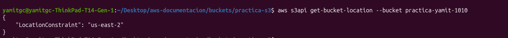
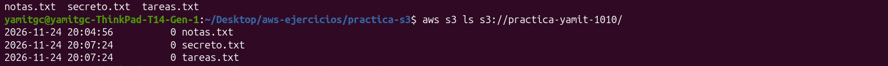
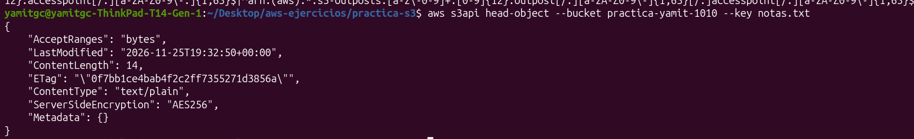
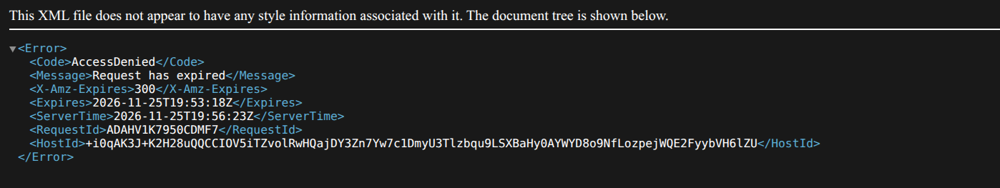
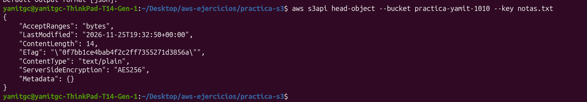
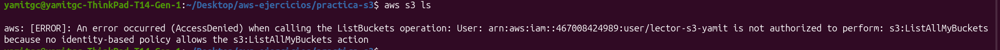
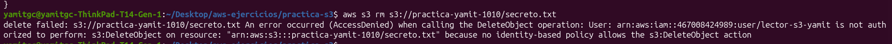
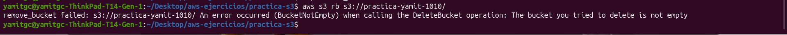
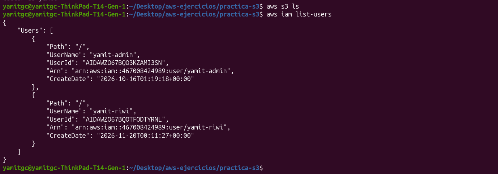

# Evidencia — Actividad: Práctica de Amazon S3 e IAM

> **Nota de seguridad:** Esta evidencia no incluye ninguna clave secreta de acceso (`SecretAccessKey`) ni credenciales sensibles.

---

## Evidencia paso a paso

### Paso 3 — Verificación de creación y región del bucket
Consulta de la ubicación del bucket `practica-yamit-1010` con `aws s3api get-bucket-location --bucket practica-yamit-1010`, confirmando su creación exitosa en la región `us-east-2`.



---

### Paso 7 — Listado de objetos subidos al bucket
Ejecución de `aws s3 ls s3://practica-yamit-1010/` verificando que los tres archivos iniciales (`notas.txt`, `secreto.txt` y `tareas.txt`) fueron cargados correctamente al bucket.



---

### Paso 13 — Inspección de metadatos de un objeto actualizado
Ejecución de `aws s3api head-object --bucket practica-yamit-1010 --key notas.txt`, mostrando los metadatos del archivo actualizado: tamaño (`ContentLength: 14`), tipo MIME (`text/plain`), `ETag`, fecha de modificación (`LastModified`) y cifrado del lado del servidor (`ServerSideEncryption: AES256`).



---

### Paso 16 — Verificación del enlace temporal (*presigned URL*) expirado
Tras probar el acceso temporal al objeto mediante una URL prefirmada con vigencia de 300 segundos (`X-Amz-Expires: 300`), se accede nuevamente después de la hora de expiración (`Expires: 2026-11-25T19:53:18Z`, `ServerTime: 2026-11-25T19:56:23Z`), comprobando que AWS S3 rechaza automáticamente la solicitud con el error XML `AccessDenied` — `Request has expired`.



---

### Paso 21 — Acción permitida con el usuario lector (`s3:GetObject`)
Con las credenciales configuradas del usuario IAM `lector-s3-yamit`, al cual se le asignó la política de solo lectura (`solo-lectura.json`) restringida exclusivamente a `s3:GetObject` sobre su propio bucket:

```json
{
  "Version": "2012-10-17",
  "Statement": [
    {
      "Effect": "Allow",
      "Action": ["s3:GetObject"],
      "Resource": "arn:aws:s3:::practica-yamit-1010/*"
    }
  ]
}
```

Se ejecuta `aws s3api head-object --bucket practica-yamit-1010 --key notas.txt`, respondiendo exitosamente con los metadatos del objeto al contar con permiso de lectura sobre `practica-yamit-1010/*`.



---

### Paso 22 — Primera acción denegada: listar buckets/objetos (`AccessDenied`)
Al ejecutar `aws s3 ls` con el usuario `lector-s3-yamit`, AWS deniega la operación con `AccessDenied`, indicando que el usuario no tiene ninguna política basada en identidad que autorice la acción `s3:ListAllMyBuckets`.



---

### Paso 23 — Segunda acción denegada: eliminar objeto (`s3:DeleteObject`)
Al intentar eliminar un archivo del bucket mediante `aws s3 rm s3://practica-yamit-1010/secreto.txt` con el usuario `lector-s3-yamit`, AWS rechaza la operación con `AccessDenied`, ya que su política no permite la acción `s3:DeleteObject` sobre `arn:aws:s3:::practica-yamit-1010/secreto.txt`.



---

### Paso 24 — Intento de eliminar el bucket sin vaciarlo (`BucketNotEmpty`)
Al ejecutar `aws s3 rb s3://practica-yamit-1010/` mientras el bucket todavía contiene objetos, AWS devuelve el error `BucketNotEmpty` (`The bucket you tried to delete is not empty`), demostrando que primero deben eliminarse todos los objetos antes de borrar el bucket.



---

### Paso 29 — Limpieza final verificada en la cuenta
Ejecución de `aws s3 ls` (sin salida, confirmando que no quedó ningún bucket de la práctica) y `aws iam list-users` (mostrando únicamente los usuarios preexistentes `yamit-admin` y `yamit-riwi`, confirmando que el usuario `lector-s3-yamit`, sus llaves de acceso y sus políticas fueron eliminados por completo).



---

## Preguntas de reflexión

### 1. ¿Por qué el nombre de tu bucket tuvo que ser distinto al de tus compañeros si cada uno tiene su propia cuenta?
Porque los nombres de los buckets en Amazon S3 pertenecen a un **espacio de nombres global único** compartido entre todas las cuentas de AWS (dentro de la misma partición), sin importar la cuenta ni la región. Esto se debe a que el nombre del bucket forma parte directa de su dirección DNS global (por ejemplo, `https://<nombre-bucket>.s3.<region>.amazonaws.com`). Por lo tanto, si otra cuenta ya está usando un nombre, ninguna otra puede crear un bucket con el mismo nombre mientras siga existiendo.

### 2. El usuario del paso 21 pudo leer un archivo, pero en el paso 22 no pudo ver la lista. ¿Qué acción le faltaba en la política?
La política del usuario `lector-s3-yamit` solo otorgaba `s3:GetObject` sobre `arn:aws:s3:::practica-yamit-1010/*`, lo cual permite leer o consultar metadatos de un objeto cuya clave exacta ya se conoce, pero **no** permite listar contenidos:
- Para listar los objetos dentro del bucket (`aws s3 ls s3://practica-yamit-1010/`), le faltaba la acción **`s3:ListBucket`** aplicada sobre el recurso del bucket sin comodín (`arn:aws:s3:::practica-yamit-1010`).
- Para listar todos los buckets de la cuenta (`aws s3 ls`, como se evidencia en el error del paso 22), le faltaba la acción **`s3:ListAllMyBuckets`**.

### 3. En la política, ¿qué significa el `/*` al final del `Resource`? ¿Qué pasaría si se quitara?
En `"Resource": "arn:aws:s3:::practica-yamit-1010/*"`, el `/*` es un comodín que representa **todos los objetos almacenados dentro del bucket** `practica-yamit-1010` (cualquier archivo o ruta interna), diferenciándolos del bucket como contenedor.

Si se quitara el `/*` y quedara únicamente `"arn:aws:s3:::practica-yamit-1010"`, el permiso aplicaría solo al recurso del bucket en sí y **no** a sus objetos. Dado que `s3:GetObject` es una acción de nivel de objeto, dejaría de coincidir con los archivos y el usuario recibiría `AccessDenied` incluso al intentar leer `notas.txt`.

### 4. ¿En qué se diferencia compartir un archivo con un enlace temporal de hacer público el bucket?
- **Enlace temporal (*presigned URL*):** otorga acceso limitado a **un único objeto** específico, para una acción concreta (por ejemplo, solo descarga) y durante un **tiempo limitado** definido al generarlo (en esta práctica, 300 segundos). Al expirar, el enlace deja de funcionar automáticamente (`Request has expired`) mientras el bucket y el resto de sus archivos permanecen completamente privados.
- **Hacer público el bucket:** expone de forma **permanente e indefinida** los objetos del bucket a cualquier persona en internet, requiere deshabilitar protecciones de acceso público (*Block Public Access*) y eleva significativamente el riesgo de fuga de datos si se suben archivos confidenciales (como `secreto.txt`) por error.

### 5. Según el modelo de responsabilidad compartida, si alguien deja un bucket público con datos de clientes, ¿de quién es la responsabilidad?
La responsabilidad es del **cliente** (el propietario o administrador de la cuenta de AWS).

Bajo el **Modelo de Responsabilidad Compartida de AWS**, AWS es responsable de la seguridad **de la nube** (infraestructura física, hardware, red y operación segura del servicio S3), mientras que el cliente es responsable de la seguridad **en la nube**: la configuración de permisos, políticas de bucket, controles de acceso público, IAM y protección de los datos que almacena.

---

## Criterios de evaluación

| Criterio | Cumple |
|---|---|
| El bucket fue creado, usado y eliminado en el orden correcto | [x] |
| Se evidencia el enlace temporal funcionando y luego expirado | [x] |
| Se evidencia una acción permitida y dos denegadas con el usuario lector | [x] |
| La política solo permite `s3:GetObject` sobre su propio bucket | [x] |
| La evidencia no expone ninguna clave secreta | [x] |
| No quedaron buckets, usuarios ni llaves de la actividad en la cuenta | [x] |
