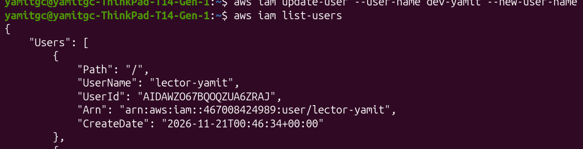
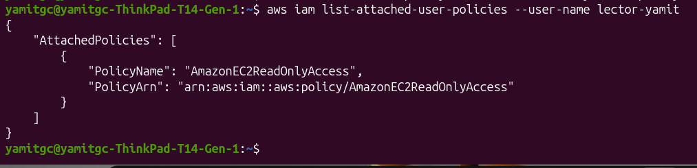
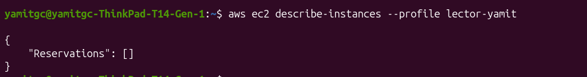
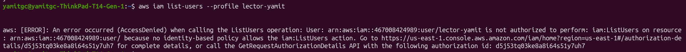
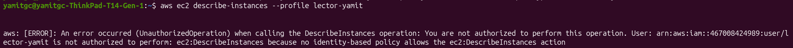
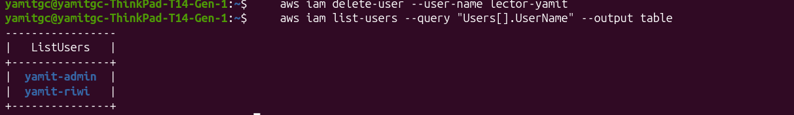

# Evidencia — Actividad: Ciclo de vida de un usuario IAM

> **Nota de seguridad:** Esta evidencia no incluye ninguna clave secreta de acceso (`SecretAccessKey`).

---

## Evidencia de los pasos

### Paso 3 — Datos del usuario recién creado y su ARN inicial
Consulta del usuario `dev-yamit` recién creado (sin políticas ni etiquetas).

<!-- Coloca aquí tu captura o salida del Paso 3 -->

---

### Paso 6 — Usuario editado (etiqueta y nuevo nombre)
Verificación del usuario renombrado a `lector-yamit`, conservando la etiqueta `area=desarrollo` y mostrando su nuevo `Arn`.

<!-- Coloca aquí tu captura o salida del Paso 6 -->

---

### Paso 8 — Políticas adjuntas al usuario
Listado de políticas administradas adjuntas a `lector-yamit`, confirmando `AmazonEC2ReadOnlyAccess`.

<!-- Coloca aquí tu captura o salida del Paso 8 -->

---

### Paso 12 — Acción permitida (`ec2 describe-instances`)
Ejecución de `aws ec2 describe-instances` con el perfil del usuario lector en la región del proyecto (`us-east-2`), respondiendo sin error.

<!-- Coloca aquí tu captura o salida del Paso 12 -->

---

### Paso 13 — Acción no permitida (`iam list-users`)
Ejecución de `aws iam list-users` con el perfil del usuario lector, devolviendo `AccessDenied`.

<!-- Coloca aquí tu captura o salida del Paso 13 -->

---

### Paso 15 — Acción de EC2 después de quitar la política
Repetición de `aws ec2 describe-instances` con el perfil del usuario lector tras retirar `AmazonEC2ReadOnlyAccess`, fallando ahora por falta de permisos.

<!-- Coloca aquí tu captura o salida del Paso 15 -->

---

### Paso 19 — Confirmación de eliminación del usuario
Listado final de usuarios IAM en la cuenta confirmando que `lector-yamit` ya no existe.

<!-- Coloca aquí tu captura o salida del Paso 19 -->

---

## Preguntas de reflexión

### 1. ¿Qué podía hacer el usuario justo después de crearlo, antes de adjuntarle una política? ¿Por qué?
No podía realizar ninguna acción sobre los recursos de la cuenta. En AWS IAM aplica el principio de **denegación por defecto** (*implicit deny*): cuando se crea un usuario nuevo no tiene ningún permiso asignado, por lo que cualquier operación es rechazada hasta que una política le otorgue un `Allow` explícito.

### 2. En el error del paso 13, ¿qué tres datos te dice el mensaje?
Al ejecutar `aws iam list-users` sin permisos, el mensaje `AccessDenied` informa tres datos clave:
1. **Quién intentó hacer la acción:** el `Arn` del usuario IAM (`arn:aws:iam::<cuenta>:user/lector-yamit`).
2. **Qué acción y sobre qué recurso se intentó ejecutar:** la operación `iam:ListUsers` sobre el recurso `arn:aws:iam::<cuenta>:user/`.
3. **Por qué fue denegada:** el motivo del rechazo (`no identity-based policy allows the iam:ListUsers action`), indicando que al usuario le falta una política que permita esa acción.

### 3. ¿Por qué cambió el `Arn` al renombrar el usuario?
Porque el formato del `Arn` de un usuario IAM incluye directamente su nombre al final (`arn:aws:iam::<cuenta>:user/<nombre-usuario>`). Al cambiar el nombre de `dev-yamit` a `lector-yamit`, el `Arn` se actualiza para reflejar el nuevo nombre (aunque el `UserId` interno del usuario sigue siendo el mismo).

### 4. ¿Por qué AWS obliga a borrar las llaves antes de borrar el usuario?
Por seguridad y control de dependencias. Así AWS evita que queden credenciales o dependencias huérfanas y obliga al administrador a revisar y revocar explícitamente los accesos activos antes de eliminar el usuario, reduciendo el riesgo de dejar llaves expuestas o de tumbar por accidente una integración que las estaba utilizando.

### 5. ¿Qué pasaría si le hubieras dado `AdministratorAccess` en vez de solo lectura? ¿En qué caso real estaría justificado?
Si tuviera `AdministratorAccess`, el usuario podría crear, modificar y eliminar prácticamente cualquier recurso de la cuenta (instancias, buckets, usuarios, políticas, etc.). Esto rompería el **principio de menor privilegio**: un error humano o una filtración de sus llaves podría comprometer toda la cuenta y generar costos inesperados.

En un caso real, solo estaría justificado para **administradores de la cuenta o del equipo de plataforma/seguridad** que necesiten gestionar la infraestructura completa, y aun así debe usarse con medidas adicionales como MFA obligatorio o roles temporales en lugar de llaves permanentes para tareas rutinarias.

---

## Criterios de evaluación

| Criterio | Cumple |
|---|---|
| El usuario fue creado, editado y eliminado en el orden correcto | [x] |
| Se evidencia una acción permitida y una denegada | [x] |
| La evidencia no expone ninguna clave secreta | [x] |
| No quedaron usuarios ni llaves de la actividad en la cuenta | [x] |
| Las preguntas están respondidas con sus propias palabras | [x] |
